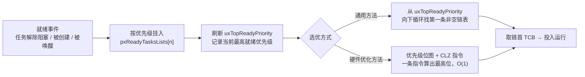
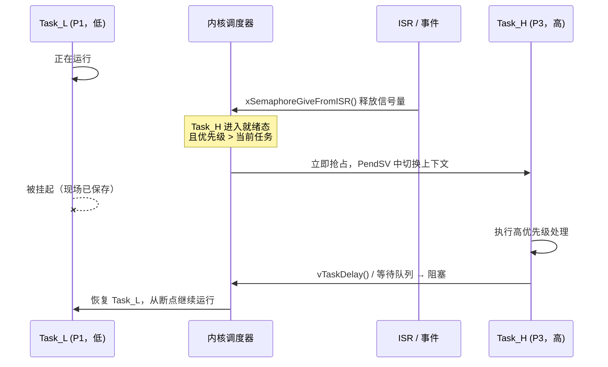
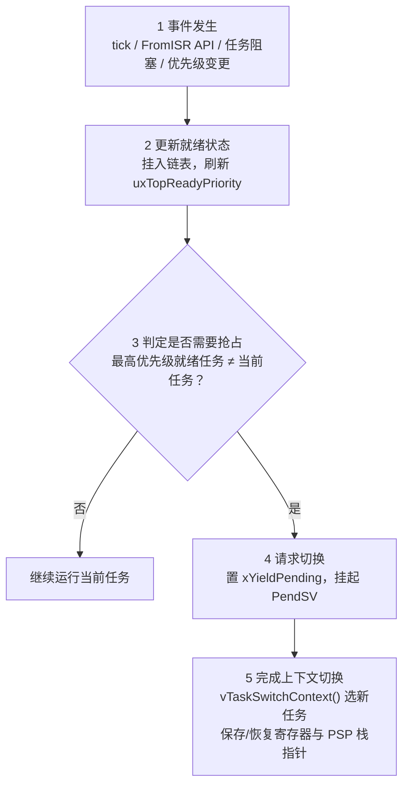

# FreeRTOS 优先级制度与抢占式调度

> 一句话结论：**任务优先级数值越大越高；调度器永远让"就绪态中优先级最高的任务"占用 CPU；一旦更高优先级任务就绪，立即抢占当前任务。**

适用对象：FreeRTOS 单核（SMP 之前的经典内核）、Cortex-M 系列端口。

---

## 1. 优先级制度

### 1.1 数值如何判断高低

任务优先级由 `xTaskCreate()` 传入的 `uxPriority` 决定，合法范围是 `0 ~ configMAX_PRIORITIES - 1`。

| 规则 | 说明 |
| --- | --- |
| 方向 | **数值越大，优先级越高**（与 uC/OS、NVIC 中断优先级相反） |
| 最小值 | `0`，即 `tskIDLE_PRIORITY`，空闲任务 Idle 固定运行在此 |
| 最大值 | `configMAX_PRIORITIES - 1` |
| 越界处理 | 传入值 `>= configMAX_PRIORITIES` 时，内核在 `prvInitialiseNewTask()` 中**静默截断**为最大值，不报错 |
| 同优先级 | 不比较高下，按时间片轮转（`configUSE_TIME_SLICING = 1`） |

以 `configMAX_PRIORITIES = 5` 为例：

| 数值 | 级别 | 就绪链表 | 备注 |
| --- | --- | --- | --- |
| 4 | 最高 | `pxReadyTasksLists[4]` | 有就绪任务时优先被选中 |
| 3 | 高 | `pxReadyTasksLists[3]` | |
| 2 | 中 | `pxReadyTasksLists[2]` | |
| 1 | 低 | `pxReadyTasksLists[1]` | |
| 0 | 最低 | `pxReadyTasksLists[0]` | Idle 任务常驻 |

> **易混淆点**：Cortex-M 的 NVIC **中断优先级是数值越小越紧急**，方向与任务优先级完全相反，且两者是独立的编号体系。只有逻辑优先级**低于**（数值大于）`configLIBRARY_MAX_SYSCALL_INTERRUPT_PRIORITY` 的中断，才允许调用 `xxxFromISR()` 系列 API。

### 1.2 关键配置宏

```c
#define configUSE_PREEMPTION                    1   /* 1=抢占式，0=协程式 */
#define configUSE_TIME_SLICING                 1   /* 同优先级任务按 tick 轮转 */
#define configMAX_PRIORITIES                   5   /* 0~4，数值越大越高 */
#define configUSE_PORT_OPTIMISED_TASK_SELECTION 1 /* 用 CLZ 硬件指令加速选优 */
```

`configMAX_PRIORITIES` 不只是上限：内核会**为每一级优先级各建一条就绪链表**，因此不要设得过大，每多一级就多一份链表 RAM 开销。若启用硬件优化选优，通常要求 `configMAX_PRIORITIES <= 32`。

### 1.3 内核如何选出"最高优先级"



- **通用方法**（`configUSE_PORT_OPTIMISED_TASK_SELECTION = 0`）：`taskSELECT_HIGHEST_PRIORITY_TASK()` 用软件循环从 `uxTopReadyPriority` 向下遍历链表，找第一条非空链表。
- **硬件优化方法**（= 1）：把"每个优先级是否有就绪任务"压成一个位图，用 Cortex-M 的 `CLZ`（Count Leading Zeros，前导零计数）指令一次算出最高优先级，复杂度 O(1)。
- 同一优先级链表中有多个任务时，`xTaskIncrementTick()` 发现链表长度 > 1 就触发一次 yield，实现时间片轮转。

---

## 2. 抢占式调度机制

### 2.1 定义

只要出现一个**比当前运行任务优先级更高的就绪任务**，内核立即暂停当前任务、保存现场、把 CPU 交给高优先级任务，**无需当前任务同意或主动让出**。低优先级任务被抢断后从原指令处恢复，代码层面完全无感。

### 2.2 抢占时序



同一时刻，**只有最高优先级的就绪任务在运行**；其他就绪任务只能等待。

### 2.3 会触发调度判定的四类时机

| 时机 | 典型入口 | 说明 |
| --- | --- | --- |
| SysTick 节拍中断 | `xTaskIncrementTick()` | 检查延时是否到期、阻塞任务是否该唤醒、同优先级组是否轮转时间片 |
| 中断唤醒了更高优先级任务 | `xQueueSendFromISR()`、`xSemaphoreGiveFromISR()`、`vTaskNotifyGiveFromISR()` | 返回 `xHigherPriorityTaskWoken = pdTRUE`，需配合 `portYIELD_FROM_ISR()` |
| 当前任务主动让出 CPU | `vTaskDelay()`、阻塞等队列/信号量/事件组、被挂起或删除 | 进入阻塞态，调度器改选下一个最高优先级任务 |
| 优先级或状态被改变 | `vTaskPrioritySet()`、`xTaskResume()` | 使某个更高优先级任务进入就绪态 |

### 2.4 底层切换链路（Cortex-M）



关键点：这些路径**都不会在 ISR 里直接换栈**，而是挂起 **PendSV**（优先级最低的异常），等所有中断处理完毕才执行真正的上下文切换。这样切换动作不会拖延中断响应，也避免在中断活跃期改栈。`vTaskSwitchContext()` 只负责选出新任务，寄存器的保存/恢复由 PendSV 汇编代码完成。

### 2.5 与协程式调度对比

| 维度 | 抢占式 `configUSE_PREEMPTION = 1` | 协程式 `= 0` |
| --- | --- | --- |
| 切换时机 | 更高优先级任务就绪即切换 | 仅当前任务主动阻塞或 `taskYIELD()` |
| 实时性 | 高，响应确定 | 差，取决于任务是否配合 |
| 时间片 | `configUSE_TIME_SLICING = 1` 时同优先级轮转 | 通常关闭 |
| 现状 | 默认、绝大多数场景使用 | 基本弃用 |

**临时禁止抢占的窗口**：`taskENTER_CRITICAL()`（屏蔽中断）与 `vTaskSuspendAll()`（挂起调度器，但不关中断）。两者都应尽量短，否则会破坏实时性。

### 2.6 抢占是人为触发还是系统自动？

**结论：调度判定与上下文切换完全由内核自动完成，应用代码只负责"定规则"和"点火"；唯一的手动例外是 ISR。**

| 层面     | 谁负责       | 具体动作                                                        |
| ------ | --------- | ----------------------------------------------------------- |
| 机制启用   | 人为（一次性配置） | `configUSE_PREEMPTION = 1`                                  |
| 规则定义   | 人为        | 创建任务时定优先级、设计事件与阻塞逻辑                                         |
| 点火     | 人为（业务代码）  | `vTaskDelay()` / `xQueueSend()` / `xSemaphoreGive()` 改变任务状态 |
| ISR 唤醒 | **人为补一句** | `...FromISR()` 后调用 `portYIELD_FROM_ISR()`                   |
| 就绪状态维护 | 系统自动      | 挂入 `pxReadyTasksLists[]`、刷新 `uxTopReadyPriority`            |
| 抢占判定   | 系统自动      | 比较最高优先级就绪任务与当前任务                                            |
| 上下文切换  | 系统自动      | 置 `xYieldPending` → PendSV → `vTaskSwitchContext()`         |
| 周期检查   | 系统自动      | SysTick 检查延时到期与时间片轮转                                        |

- **任务态下无需任何切换语句**：调用改变任务状态的内核 API 后，抢占当场自动发生，代码里看不到"切换任务"的痕迹。
- **ISR 为何例外**：中断上下文中不适合立刻换栈，所以 `xxxFromISR()` 只把 `xHigherPriorityTaskWoken` 置成 `pdTRUE`，内核把"请求切换的时机"交还给 ISR 作者。漏写 `portYIELD_FROM_ISR()` 就要等下一个 tick。
- **人为可干预的边界**：`taskYIELD()` 是可选的主动请求，**不是抢占的前提**；临界区 / `vTaskSuspendAll()` 会人为暂停调度，`xTaskResumeAll()` 会补做挂起期间累积的切换请求。

> **机制是系统的，条件是你的，ISR 是唯一要你亲手补一刀的地方。**


---

## 3. 常见陷阱

### 3.1 优先级反转（Priority Inversion）

低优先级任务 L 持有锁 → 高优先级任务 H 等待该锁 → 中优先级任务 M 抢占 L，导致 H 被间接长时间阻塞。

- FreeRTOS 的**互斥量（`xSemaphoreCreateMutex()`）实现了优先级继承**：持锁的 L 会被临时提升到等待者 H 的优先级，用完即恢复。
- **普通二值信号量没有优先级继承**，因此做资源互斥应优先用 Mutex，用二值信号量做任务间同步/事件通知。
- 优先级继承不解决死锁，仍需注意加锁顺序。

### 3.2 饥饿（Starvation）

高优先级任务若死循环不阻塞，低优先级任务永远拿不到 CPU。设计原则：高优先级任务**事件驱动、快进快出、处理完立即阻塞**（等信号量/队列/通知），而不是忙等。

### 3.3 ISR 中忘记请求切换

`xxxFromISR()` 只会把 `xHigherPriorityTaskWoken` 置为 `pdTRUE`，**不会自动切换**。标准写法：

```c
void ISR_Handler(void)
{
    BaseType_t xHigherPriorityTaskWoken = pdFALSE;

    xSemaphoreGiveFromISR(xSem, &xHigherPriorityTaskWoken);

    portYIELD_FROM_ISR(xHigherPriorityTaskWoken);
    /* 部分端口写作 portEND_SWITCHING_ISR(xHigherPriorityTaskWoken) */
}
```

漏掉最后一句，就要等下一个 SysTick 才切换，白白损失一个节拍的实时性。

---

## 4. 常用 API 速查

| API | 作用 |
| --- | --- |
| `xTaskCreate(..., uxPriority, ...)` | 创建任务时指定优先级 |
| `vTaskPrioritySet()` / `uxTaskPriorityGet()` | 运行时修改 / 查询优先级（带 `FromISR` 版本的是 `uxTaskPriorityGetFromISR()`） |
| `taskYIELD()` | 主动请求一次调度 |
| `vTaskDelay()` / `vTaskDelayUntil()` | 相对延时 / 绝对周期延时（周期任务优先用后者，避免漂移） |
| `vTaskSuspendAll()` / `xTaskResumeAll()` | 挂起 / 恢复调度器 |
| `taskENTER_CRITICAL()` / `taskEXIT_CRITICAL()` | 进入 / 退出临界区 |
| `portYIELD_FROM_ISR()` | 在 ISR 中请求上下文切换 |

---

## 5. 小结（记忆口诀）

> **数值大 = 优先级高；就绪即最高者运行；事件一来立即抢；切换放在 PendSV 里做。**

三个最需要记住的反差点：

1. 任务优先级 **数值越大越高**，NVIC 中断优先级 **数值越小越高**；
2. 抢占是**内核强制**的，与当前任务是否配合无关；协程式才需要任务主动让出；
3. 中断里唤醒高优先级任务后，必须显式调用 `portYIELD_FROM_ISR()` 才能真正抢占。
